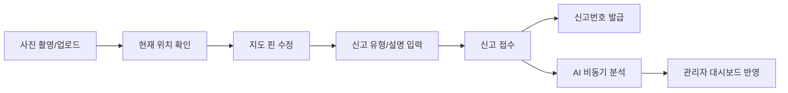
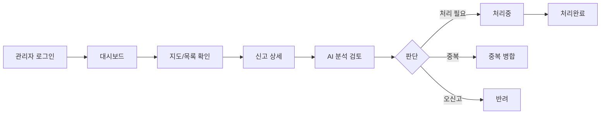
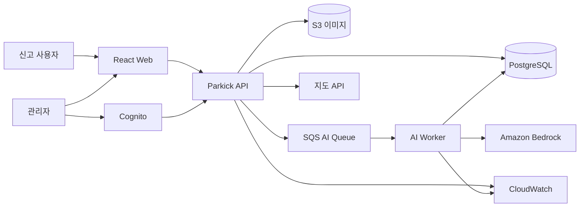
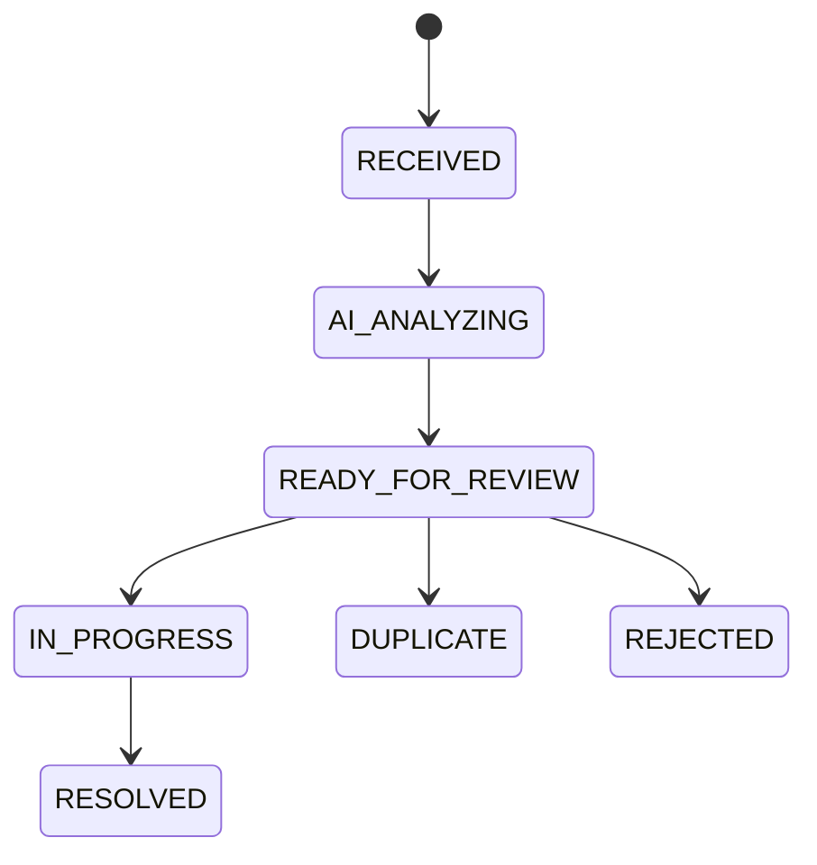

# Parkick(파킥) 프로젝트 구현 계획서

> **프로젝트명:** Parkick(파킥)  
> **의미:** Parking + Kickboard  
> **한 줄 정의:** 공유 PM(Personal Mobility)의 부적정 주차를 시민이 빠르게 신고하고, 관리자가 지도와 AI 분석을 통해 신고를 효율적으로 분류·처리하는 웹 기반 운영 플랫폼  
> **문서 버전:** v1.0  
> **작성 기준일:** 2026-10-08

---

## 0. 문서 목적과 전제

이 문서는 Parkick을 **학부 캡스톤/졸업작품 수준의 실제 동작 가능한 서비스**로 구현하면서, 동시에 **AI 융합 학술대회에서 실험 결과를 제시할 수 있는 연구형 프로젝트**로 발전시키기 위한 구현 계획서다.

핵심 원칙은 다음과 같다.

1. **신고 플랫폼이 먼저, AI는 보조 기능으로 설계한다.** AI 장애가 발생해도 신고 접수 자체는 가능해야 한다.
2. **AI는 행정적·법적 판단을 대신하지 않는다.** AI는 신고 유형, 요약, 우선순위를 추천하고 최종 판단은 관리자가 한다.
3. **사용자는 최소 단계로 신고한다.** 사진, 위치, 유형, 간단한 설명만으로 신고가 완료되어야 한다.
4. **관리자는 한 화면에서 현황을 파악한다.** 지도, 목록, 처리상태, 우선순위, 통계를 함께 제공한다.
5. **개인정보와 위치정보를 최소 수집한다.** 이미지 EXIF 제거, 텍스트 개인정보 마스킹, 비공개 S3 저장을 기본으로 한다.
6. **AWS Bedrock 모델은 교체 가능한 구조로 구현한다.** 현재 사용 가능한 US Region 모델(Haiku 4.5, GPT-5.6 Luna, Nova Micro, Nova Lite 등)을 `.env`/설정값으로 바꿔가며 실험할 수 있게 한다.

> **범위 주의:** Parkick v1은 “불법 여부를 자동 판정하는 시스템”이 아니다. 정확한 법적 금지구역·지자체 처리규정은 실제 도입 지역의 정책 검증 후 별도 규칙으로 반영한다.

---

# 1. 프로젝트 개요

## 1.1 문제 정의

공유 전동킥보드 등 PM이 보도, 점자블록, 횡단보도 주변, 건물 출입구 등 통행을 방해하는 위치에 방치되면 시민 불편과 안전 문제가 발생한다. 신고 채널이 있더라도 사용자는 절차가 복잡하다고 느낄 수 있고, 운영자는 다수의 신고를 개별 확인·분류·정리해야 하므로 처리 효율이 떨어질 수 있다.

Parkick은 이 문제를 다음 두 관점에서 해결한다.

- **시민 관점:** 사진과 현재 위치를 활용하여 1분 내외로 신고할 수 있는 간결한 모바일 웹 제공
- **관리자 관점:** 지도 기반 신고 현황, 상태 관리, AI 자동 분류/요약, 중복 신고 묶기, 통계 제공

## 1.2 목표

### 서비스 목표

- 공유 PM 부적정 주차 신고 절차 단순화
- 위치 중심 신고 관리 체계 구축
- 관리자 업무 흐름을 `접수 → 확인 → 처리중 → 완료`로 표준화
- AI를 통한 신고 분류·요약·우선순위 추천
- 중복 신고를 묶어 불필요한 반복 확인 감소

### 연구 목표

- 생성형 AI가 신고 내용을 정해진 카테고리로 얼마나 정확히 분류하는지 측정
- 모델별 분류 정확도, 출력 안정성, 응답시간, 비용 비교
- 이미지+텍스트 입력이 가능한 모델의 PM 상황 분석 가능성 확인
- 최종적으로 **“AI 보조가 관리 업무에 실용적인 수준인지”**를 수치로 제시

## 1.3 주요 사용자

| 사용자 | 목적 | 핵심 기능 |
|---|---|---|
| 신고 시민 | 빠르게 PM 주차 문제 신고 | 사진, GPS, 유형 선택, 설명, 신고 상태 확인 |
| 관리자 | 신고 현황 파악 및 처리 | 지도, 목록, 필터, 상세보기, 상태변경, AI 분석 |
| 연구/운영 담당자 | AI 성능 및 운영 데이터 분석 | 모델별 실험, CSV 추출, 정확도/지연시간/비용 비교 |

---

# 2. 구현 범위와 우선순위

## 2.1 P0 - 반드시 구현할 MVP

- [ ] 모바일 중심 신고 페이지
- [ ] 사진 1장 이상 업로드
- [ ] 브라우저 GPS로 현재 위치 취득
- [ ] 지도에서 신고 위치 수정
- [ ] 신고 유형 선택 및 설명 입력
- [ ] 신고번호/조회 토큰 발급
- [ ] 관리자 로그인
- [ ] 관리자 신고 목록 및 상세보기
- [ ] 지도 기반 신고 마커 표시
- [ ] 처리 상태 변경
- [ ] S3 이미지 저장
- [ ] PostgreSQL 신고 데이터 저장
- [ ] Bedrock 기반 텍스트 분류·요약
- [ ] AI 분석 실패 시에도 신고 정상 접수
- [ ] 개인정보 마스킹 및 이미지 EXIF 제거
- [ ] 기본 로그/에러 처리

## 2.2 P1 - 학술대회/캡스톤 완성도 향상

- [ ] 이미지+텍스트 기반 PM 존재 여부/개수/상황 분석
- [ ] AI 우선순위 추천
- [ ] 거리+시간 기반 중복 신고 자동 후보 생성
- [ ] 관리자 대시보드 통계
- [ ] 모델 교체 및 A/B 실험 기능
- [ ] AI 판단과 관리자 최종 판단 비교 로그
- [ ] 실험 결과 CSV/JSON 내보내기
- [ ] 신고 처리 이력(Audit Log)
- [ ] 관리자용 지도 클러스터링

## 2.3 P2 - 향후 확장

- [ ] 사진 유사도 기반 중복 신고 탐지
- [ ] 얼굴/차량번호판 자동 비식별화
- [ ] 시민 신고 처리 결과 알림
- [ ] PWA 설치 및 카메라 최적화
- [ ] 운영사/지자체 시스템 API 연동
- [ ] 지역별 금지/주의 구역 정책 룰 엔진
- [ ] 신고 밀집지역 히트맵 및 시간대 분석
- [ ] 운영사별 통계/배정 기능

## 2.4 이번 버전에서 의도적으로 제외할 것

- 시민 회원가입/소셜 로그인
- 결제 기능
- 실제 과태료/법적 위반 자동 판정
- 복잡한 조직/다중 지자체 권한 체계
- 운영사 자동 출동 배차
- 대규모 실시간 스트리밍 처리

---

# 3. 사용자 시나리오

## 3.1 신고 사용자 흐름



### 신고 단계

1. 사용자가 `신고하기` 버튼을 누른다.
2. 사진을 촬영하거나 갤러리에서 선택한다.
3. 브라우저 위치 권한을 요청하여 위도/경도를 가져온다.
4. 지도에 핀을 표시하고 사용자가 위치를 수정할 수 있게 한다.
5. 사용자가 주차 문제 유형을 선택한다.
6. 필요한 경우 짧은 설명을 입력한다.
7. 서버는 이미지를 업로드하고 신고 데이터를 저장한다.
8. 사용자에게 **신고번호 + 조회 토큰**을 제공한다.
9. AI 분석은 비동기로 실행한다. AI 실패는 신고 접수 성공 여부에 영향을 주지 않는다.

## 3.2 관리자 흐름



관리자는 AI 결과를 참고하되 직접 수정할 수 있어야 한다. 수정된 값은 별도로 저장하여 향후 AI 평가용 정답 데이터로 활용할 수 있게 한다.

---

# 4. 화면 및 정보구조(IA)

## 4.1 사용자 화면

### `/` 메인

- Parkick 로고와 서비스 설명
- `신고하기` CTA
- `내 신고 확인`
- `올바른 PM 주차 안내`
- 신고 사진 촬영 시 개인정보 주의 안내

### `/report` 신고 작성

- 사진 촬영/업로드
- 현재 위치 가져오기
- 지도 핀 조정
- 신고 유형
  - 보행로 통행 방해
  - 점자블록/교통약자 이동 방해
  - 횡단보도/교차로 주변
  - 차도/자전거도로 통행 방해
  - 건물/시설 출입구 방해
  - 전도/파손 등 위험 상황
  - 기타
- 추가 설명
- 개인정보 포함 주의문
- 신고 버튼

> 카테고리는 법적 판정명이 아니라 **운영 분류명**으로 사용하며, 실제 지자체 적용 시 정책에 맞춰 관리자 설정값으로 관리한다.

### `/report/complete`

- 신고 완료
- 신고번호
- 조회용 토큰/링크
- 접수 시각
- 현재 처리상태

### `/status`

- 신고번호 + 조회 토큰 입력
- 상태 조회
- 접수/처리중/완료 타임라인

## 4.2 관리자 화면

### `/admin/login`

- 관리자 인증
- 초기 버전은 Cognito 또는 단일 관리자 계정으로 단순화

### `/admin/dashboard`

상단 KPI:

- 오늘 신고 수
- 미처리 수
- 처리중 수
- 완료 수
- AI 분석 실패 수

본문:

- 지도 신고 마커
- 긴급/우선처리 추천 목록
- 최근 신고
- 유형별 신고 비율
- 시간대별 신고 추이

### `/admin/reports`

필터:

- 상태
- 날짜
- 행정구역
- 신고 유형
- AI 우선순위
- 중복 후보 여부

표시 컬럼:

- 신고번호
- 썸네일
- 주소
- 사용자 선택 유형
- AI 추천 유형
- AI 우선순위
- 접수시각
- 상태

### `/admin/reports/:id`

- 원본 신고 사진
- 지도 위치
- 신고 원문(마스킹 적용본)
- 사용자 선택 카테고리
- AI 분석 결과
- AI 모델명/처리시간
- 중복 신고 후보
- 관리자 최종 분류
- 상태 변경
- 처리 메모
- 이력

### `/admin/analytics`

- 일/주/월 신고 추이
- 유형별 비율
- 지역별 신고 건수
- 평균 처리시간
- AI 모델별 분류 정확도
- AI JSON 출력 성공률
- 모델별 평균 지연시간/토큰/비용

---

# 5. 권장 기술 스택

## 5.1 프론트엔드

| 항목 | 선택 | 이유 |
|---|---|---|
| Framework | React + TypeScript + Vite | 빠른 개발, 캡스톤 시연에 적합 |
| Styling | Tailwind CSS | 반응형 UI 구현 속도 |
| Data Fetching | TanStack Query | 서버 상태/캐시/에러 처리 |
| Form | React Hook Form + Zod | 입력 검증 일원화 |
| Map | Kakao Maps 또는 국내 지도 API | 국내 주소/좌표 표시에 적합 |
| Charts | Recharts | 대시보드 차트 구현 |

## 5.2 백엔드

| 항목 | 선택 | 이유 |
|---|---|---|
| Runtime | Node.js + TypeScript | 프론트와 언어 통일 |
| API | Express 또는 Fastify | 구조 단순, 빠른 MVP |
| ORM | Prisma | PostgreSQL 스키마/마이그레이션 관리 |
| Validation | Zod | API 요청/AI JSON 스키마 검증 |
| DB | PostgreSQL | 위치·상태·이력 데이터에 적합 |
| Queue | Amazon SQS | AI 분석 비동기 처리 |

## 5.3 AWS

| 목적 | AWS 서비스 |
|---|---|
| 프론트 배포 | S3 + CloudFront |
| 백엔드 | ECS Fargate 또는 EC2 기반 Node.js API |
| DB | RDS PostgreSQL |
| 이미지 | Private S3 Bucket |
| AI | Amazon Bedrock (US Region) |
| 비동기 작업 | SQS |
| 관리자 인증 | Cognito |
| 로그/모니터링 | CloudWatch |
| 비밀값 | Secrets Manager / Parameter Store |

### 개발 초기 단계

AWS 전체를 한 번에 구축하지 않는다.

```text
Local React/Vite
    +
Local Node API
    +
Docker PostgreSQL
    +
AWS S3(dev bucket)
    +
AWS Bedrock
```

기능 검증 후 배포 인프라를 구성한다.

---

# 6. 전체 시스템 아키텍처



## 6.1 핵심 설계 원칙

### 신고 접수와 AI 분석 분리

신고 API가 Bedrock 응답을 기다리면 AI 지연/오류가 사용자 신고 실패로 이어질 수 있다. 따라서 다음 방식으로 분리한다.

```text
신고 저장 성공
    ↓
사용자에게 즉시 신고번호 반환
    ↓
SQS에 AI 분석 Job 생성
    ↓
Worker가 Bedrock 호출
    ↓
결과를 DB에 저장
```

### 모델 어댑터

Bedrock 모델별 API 차이를 서비스 코드에 직접 퍼뜨리지 않고 `ModelAdapter` 인터페이스로 감싼다.

```ts
interface ModelAdapter {
  analyzeReport(input: AnalyzeReportInput): Promise<ReportAnalysis>;
}
```

`.env` 또는 DB 설정에서 모델을 교체한다.

```env
AWS_REGION=us-east-1
BEDROCK_TEXT_MODEL_ID=...
BEDROCK_VISION_MODEL_ID=...
```

실제 Model ID는 AWS 계정에서 접근 가능한 Bedrock Model Access 기준으로 지정한다.

---

# 7. 신고 상태 모델

내부 상태는 세분화하되 사용자에게는 단순하게 보여준다.



| 내부 상태 | 사용자 표시 | 의미 |
|---|---|---|
| `RECEIVED` | 접수 | 신고 저장 완료 |
| `AI_ANALYZING` | 접수 | AI 분석 진행중 |
| `READY_FOR_REVIEW` | 확인중 | 관리자 검토 대기 |
| `IN_PROGRESS` | 처리중 | 조치 진행 |
| `RESOLVED` | 처리완료 | 처리 종료 |
| `DUPLICATE` | 통합처리 | 다른 신고와 동일 건 |
| `REJECTED` | 확인완료 | 오신고/처리대상 아님 |

---

# 8. 데이터베이스 설계

## 8.1 핵심 테이블

### `reports`

| 필드 | 타입 | 설명 |
|---|---|---|
| `id` | UUID PK | 내부 식별자 |
| `public_code` | VARCHAR UNIQUE | 사용자에게 노출되는 신고번호 |
| `lookup_token_hash` | VARCHAR | 비회원 상태조회 토큰 해시 |
| `latitude` | DECIMAL | 위도 |
| `longitude` | DECIMAL | 경도 |
| `address` | VARCHAR | 역지오코딩 주소 |
| `user_category` | ENUM/VARCHAR | 사용자가 선택한 유형 |
| `description_masked` | TEXT | 개인정보 마스킹 후 설명 |
| `status` | ENUM | 처리 상태 |
| `priority_final` | VARCHAR | 관리자 최종 우선순위 |
| `duplicate_group_id` | UUID nullable | 중복 그룹 |
| `created_at` | TIMESTAMP | 접수시각 |
| `updated_at` | TIMESTAMP | 수정시각 |

### `report_images`

| 필드 | 설명 |
|---|---|
| `id` | 이미지 ID |
| `report_id` | 신고 FK |
| `s3_key` | Private S3 Object Key |
| `sha256` | 중복/무결성 확인 |
| `mime_type` | MIME |
| `exif_removed` | EXIF 제거 여부 |
| `created_at` | 저장시각 |

### `ai_analyses`

| 필드 | 설명 |
|---|---|
| `id` | 분석 ID |
| `report_id` | 신고 FK |
| `model_id` | Bedrock 모델 식별자 |
| `prompt_version` | 프롬프트 버전 |
| `schema_version` | JSON 스키마 버전 |
| `pm_detected` | PM 탐지 여부 |
| `pm_count` | 추정 대수 |
| `category_ai` | AI 추천 유형 |
| `summary` | 관리자용 요약 |
| `priority_ai` | AI 추천 우선순위 |
| `confidence` | 모델 신뢰도 표현(보조지표) |
| `safety_flags` | 민감정보/이상 응답 플래그 |
| `latency_ms` | AI 응답시간 |
| `input_tokens` | 입력 토큰 |
| `output_tokens` | 출력 토큰 |
| `raw_response_json` | 원본 구조화 응답 |
| `created_at` | 분석시각 |

### `admin_actions`

| 필드 | 설명 |
|---|---|
| `id` | 이력 ID |
| `report_id` | 신고 FK |
| `admin_id` | 관리자 |
| `action` | 상태 변경/분류 수정/메모 등 |
| `from_value` / `to_value` | 변경 전/후 |
| `created_at` | 시각 |

### `duplicate_groups`

- 대표 신고 ID
- 그룹 생성 방식(`DISTANCE_TIME`, `IMAGE_SIMILARITY`, `MANUAL`)
- 생성시각

## 8.2 중요한 데이터 원칙

- 위치는 서비스 목적상 필요하지만 공개 화면에 정확 좌표를 노출하지 않는다.
- 신고 원문의 개인정보는 저장 전에 마스킹하는 방식을 우선한다.
- 원본 사진은 Private S3에 저장하고 관리자만 제한적으로 접근한다.
- AI 결과와 관리자 수정값을 분리 저장하여 연구용 정답 데이터로 사용할 수 있게 한다.

---

# 9. API 설계 초안

## 9.1 Public API

### `POST /api/v1/uploads/presign`

신고 이미지 업로드용 Presigned URL 생성.

요청:

```json
{
  "fileName": "report.jpg",
  "contentType": "image/jpeg",
  "fileSize": 1830021
}
```

응답:

```json
{
  "uploadUrl": "...",
  "objectKey": "reports/temp/..."
}
```

### `POST /api/v1/reports`

신고 생성.

```json
{
  "imageKeys": ["reports/temp/..."],
  "latitude": 37.0000,
  "longitude": 127.0000,
  "userCategory": "SIDEWALK_OBSTRUCTION",
  "description": "인도 중앙에 킥보드 두 대가 쓰러져 있습니다."
}
```

응답:

```json
{
  "publicCode": "PK-20261008-7F3A2",
  "lookupToken": "one-time-secret-token",
  "status": "RECEIVED"
}
```

### `POST /api/v1/reports/status`

비회원 상태 조회.

```json
{
  "publicCode": "PK-20261008-7F3A2",
  "lookupToken": "..."
}
```

## 9.2 Admin API

- `GET /api/v1/admin/dashboard/summary`
- `GET /api/v1/admin/reports`
- `GET /api/v1/admin/reports/:id`
- `PATCH /api/v1/admin/reports/:id/status`
- `PATCH /api/v1/admin/reports/:id/classification`
- `POST /api/v1/admin/reports/:id/merge-duplicate`
- `POST /api/v1/admin/reports/:id/reanalyze`
- `GET /api/v1/admin/map/markers`
- `GET /api/v1/admin/analytics`
- `GET /api/v1/admin/experiments/export.csv`

## 9.3 API 공통 규칙

- 모든 요청/응답 Zod 검증
- 관리자 API는 인증 토큰 필수
- Public 신고 API Rate Limit 적용
- 파일 형식/MIME/크기 검증
- API 에러 응답 형식 통일

```json
{
  "error": {
    "code": "INVALID_LOCATION",
    "message": "신고 위치를 확인해 주세요."
  }
}
```

---

# 10. AI 기능 설계

## 10.1 AI의 역할

AI는 다음 4개 기능만 담당한다.

1. **신고 유형 추천**
2. **관리자용 요약 생성**
3. **우선순위 추천**
4. **이미지 사용 가능 모델의 경우 PM 존재 여부/개수/상황 보조 분석**

AI는 다음을 하지 않는다.

- 법적 위반 확정
- 과태료 판단
- 사용자 신원 추정
- 얼굴/번호판 인물 식별
- 자동 신고 삭제
- 자동 행정처분

## 10.2 AI 출력 스키마

모델 응답은 자유 텍스트가 아니라 가능한 한 JSON으로 강제한다.

```json
{
  "pmDetected": true,
  "pmCount": 2,
  "category": "SIDEWALK_OBSTRUCTION",
  "summary": "보행로 중앙에 공유 PM 2대가 방치되어 통행을 방해하는 신고",
  "priority": "HIGH",
  "reason": "보행 동선을 직접 막고 있음",
  "confidence": 0.82,
  "privacyRisk": false
}
```

서버는 Zod로 파싱하며 실패하면 1회 재시도 후 `AI_FAILED`로 기록한다. AI 실패 시 신고는 그대로 유지한다.

## 10.3 모델 활용 전략

### 초기 운영 후보

- **Nova Lite:** 이미지+텍스트 분석 후보
- **Nova Micro:** 저비용 텍스트 분류/요약 후보
- **Haiku 4.5 / GPT-5.6 Luna:** 계정에서 지원되는 입력 유형과 비용을 확인하여 대체/비교 모델로 사용

실제 서비스 코드에서는 모델명을 하드코딩하지 않고 설정값으로 관리한다.

## 10.4 프롬프트 설계 원칙

- 입력 문장과 이미지 속 텍스트를 **신뢰할 수 없는 데이터**로 취급
- 사용자 내용 속 “이 지시를 무시하고...” 같은 문장을 시스템 지시로 실행하지 않음
- 허용 카테고리 목록을 명확히 제시
- 법적 확정 표현 금지
- 근거 없는 위치/PM 수량 추측 금지
- JSON 외 텍스트 출력 금지
- 프롬프트 버전을 DB에 기록

## 10.5 개인정보 마스킹

Bedrock 호출 전 텍스트에 대해 1차 규칙 기반 마스킹을 수행한다.

예:

```text
010-1234-5678 → [PHONE]
abc@example.com → [EMAIL]
주민등록번호 형식 → [ID_NUMBER]
```

이미지에 포함된 개인정보 비식별화는 P1/P2로 확장하되, 최소한 다음을 P0에서 적용한다.

- EXIF GPS/촬영기기 메타데이터 제거
- S3 Public Access Block
- 관리자 화면 외 원본 이미지 URL 노출 금지

---

# 11. 중복 신고 탐지

## 11.1 P1 기본 방식

AI를 쓰지 않고도 먼저 규칙 기반으로 구현한다.

중복 후보 조건 예시:

- 신고 위치 거리 ≤ 20~30m
- 신고 시간 차이 ≤ 30분
- 동일/유사 신고 유형
- 기존 신고 상태가 완료되지 않음

거리 계산은 Haversine 공식을 사용한다.

```text
후보점수 = 거리점수 + 시간점수 + 카테고리일치점수
```

점수가 기준 이상이면 “중복 가능성”으로 관리자에게 보여주고, 자동 병합하지 않는다.

## 11.2 P2 고도화

- 이미지 perceptual hash
- 이미지 embedding 유사도
- 동일 PM 특징 비교
- 위치·시간·이미지 통합 점수

---

# 12. 관리자 우선순위 추천

우선순위는 **AI 단독 결정값**이 아니라 정책 규칙과 AI 추천을 함께 표시한다.

예:

```text
Rule Priority: HIGH
AI Priority: HIGH
Final Priority: 관리자 선택
```

정책 룰의 예시는 다음과 같이 구성할 수 있으나, 실제 운영 기준은 적용 기관의 정책 확인 후 확정한다.

- 보행 동선 직접 차단
- 점자블록/교통약자 이동 동선 방해
- 차도/자전거도로 위험
- 넘어져 있어 2차 사고 가능성
- 출입구 방해

관리자가 변경한 최종 우선순위는 AI 평가용 데이터로 저장한다.

---

# 13. 보안·개인정보 설계

## 13.1 인증/권한

- 시민 신고: 비회원 허용
- 관리자: Cognito/JWT 인증
- 관리자 Role 기반 API 보호
- 관리자 행동은 Audit Log 기록

## 13.2 파일 보안

- Presigned PUT으로 업로드
- 허용 MIME: JPEG/PNG/WebP 중심
- 최대 파일 크기 제한
- 파일명 대신 UUID Object Key 사용
- S3 Public Access Block
- 서버/관리자용 Presigned GET만 발급
- 업로드 후 EXIF 제거 버전으로 교체

## 13.3 API 보안

- HTTPS
- CORS Allowlist
- Rate Limit
- Body Size Limit
- ORM 사용 및 입력값 검증
- 관리자 API 인증 미들웨어
- 비밀키 Git 커밋 금지
- 운영 AWS 자격증명은 IAM Role 사용

## 13.4 개인정보 최소화

- 신고자 이름/전화번호를 기본적으로 받지 않음
- 정확 위치는 운영 목적에만 사용
- 텍스트 개인정보 마스킹
- 사진 보관기간 설정 가능하게 설계
- 연구 데이터셋으로 내보낼 때 위치/이미지/식별정보 익명화

---

# 14. 프로젝트 폴더 구조

`pnpm workspace` 기반 모노레포를 권장한다.

```text
parkick/
├─ apps/
│  ├─ web/                    # React/Vite 사용자+관리자 UI
│  │  └─ src/
│  │     ├─ pages/
│  │     ├─ features/
│  │     │  ├─ report/
│  │     │  ├─ map/
│  │     │  ├─ admin/
│  │     │  └─ analytics/
│  │     ├─ components/
│  │     ├─ api/
│  │     └─ routes/
│  ├─ api/                    # Node API
│  │  └─ src/
│  │     ├─ routes/
│  │     ├─ services/
│  │     │  ├─ reports/
│  │     │  ├─ storage/
│  │     │  ├─ privacy/
│  │     │  ├─ duplicate/
│  │     │  └─ maps/
│  │     ├─ repositories/
│  │     ├─ middleware/
│  │     └─ lib/
│  └─ worker/                 # SQS + Bedrock AI Worker
│     └─ src/
│        ├─ adapters/
│        │  └─ bedrock/
│        ├─ prompts/
│        ├─ schemas/
│        └─ jobs/
├─ packages/
│  ├─ shared/                 # 공통 타입/enum/Zod schema
│  └─ ui/                     # 선택: 공통 UI
├─ prisma/
│  ├─ schema.prisma
│  └─ migrations/
├─ infra/
│  ├─ docker/
│  └─ aws/
├─ experiments/
│  ├─ datasets/
│  ├─ runners/
│  └─ results/
├─ docs/
│  ├─ architecture.md
│  ├─ api.md
│  ├─ ai-evaluation.md
│  └─ privacy.md
├─ .env.example
├─ pnpm-workspace.yaml
└─ README.md
```

---

# 15. 개발 환경 변수

```env
NODE_ENV=development
PORT=4000
DATABASE_URL=postgresql://...

AWS_REGION=us-east-1
S3_REPORT_BUCKET=parkick-dev-reports
SQS_AI_QUEUE_URL=...
BEDROCK_TEXT_MODEL_ID=...
BEDROCK_VISION_MODEL_ID=...

KAKAO_MAP_APP_KEY=...
KAKAO_REST_API_KEY=...

COGNITO_USER_POOL_ID=...
COGNITO_CLIENT_ID=...

REPORT_IMAGE_MAX_MB=10
REPORT_RETENTION_DAYS=90
```

운영환경에서는 Access Key를 `.env`에 두지 않고 IAM Role을 사용한다.

---

# 16. 구현 단계별 계획

## Phase 0. 프로젝트 초기화

**목표:** 모든 팀원이 같은 환경에서 실행 가능한 기본 골격 완성

작업:

- Git Repository 생성
- pnpm workspace 구성
- React/Vite/TypeScript 초기화
- Node API 초기화
- Docker PostgreSQL 구성
- Prisma schema 초안
- ESLint/Biome/Prettier 중 팀 규칙 확정
- `.env.example` 작성
- GitHub Actions 최소 CI(Typecheck + Lint + Test)

완료 기준:

```text
pnpm install
pnpm dev
```

한 번으로 Web/API가 실행되고 DB 연결이 성공한다.

## Phase 1. 신고 기능

**목표:** AI 없이 신고 전체 흐름 완성

작업:

- 신고 폼
- 사진 선택/미리보기
- Presigned S3 Upload
- GPS 위치
- 지도 핀
- 신고 카테고리
- 신고 생성 API
- 신고번호/조회 토큰
- 상태조회 화면
- EXIF 제거

완료 기준:

- 모바일 브라우저에서 사진+위치 신고 가능
- DB에 신고 저장
- S3에 이미지 저장
- 신고번호로 상태조회 가능

## Phase 2. 관리자 운영 기능

**목표:** 관리자가 신고를 실제로 처리할 수 있음

작업:

- 관리자 로그인
- 신고 목록/필터
- 신고 상세
- 지도 마커
- 처리 상태 변경
- 처리 메모
- Audit Log
- 기본 KPI

완료 기준:

- 관리자가 접수부터 완료까지 상태를 변경 가능
- 모든 상태 변경이 이력으로 남음

## Phase 3. Bedrock AI 연동

**목표:** 신고 분류/요약 자동화

작업:

- SQS Job 생성
- Worker 구성
- Bedrock adapter
- JSON schema
- 텍스트 마스킹
- 모델별 설정
- 재시도/Timeout
- AI 결과 DB 저장
- 관리자 상세 화면에 AI 분석 표시

완료 기준:

- AI 장애 시 신고 접수 영향 없음
- 분석 성공 시 카테고리/요약/우선순위가 저장됨
- 모델명, 지연시간, 토큰 사용량 기록

## Phase 4. 중복/통계/연구 기능

**목표:** 학술대회와 캡스톤 차별화

작업:

- 거리+시간 중복 후보 탐색
- 관리자 병합
- 통계 대시보드
- AI/관리자 판단 비교
- 실험 Runner
- CSV/JSON Export

완료 기준:

- 동일 데이터셋으로 모델별 반복 실험 가능
- 결과 파일을 논문 표/그래프로 바로 활용 가능

## Phase 5. 배포/품질

- Production S3/CloudFront
- Backend 배포
- RDS
- CloudWatch
- Secrets
- HTTPS/CORS
- E2E 테스트
- 모바일 실기기 테스트
- README 및 시연 시나리오

---

# 17. 10월 28일 학술대회 제출을 고려한 단기 일정

| 기간 | 목표 | 산출물 |
|---|---|---|
| 10/08~10/10 | 구조 확정/Repo/DB/UI 골격 | 실행 가능한 Web/API, ERD 초안 |
| 10/11~10/14 | 사용자 신고 기능 | 사진+위치+신고 저장 |
| 10/15~10/17 | 관리자 기능 | 목록/상세/지도/상태변경 |
| 10/18~10/20 | Bedrock 연결 | 분류/요약/AI 결과 저장 |
| 10/21~10/23 | 중복 후보/통계 | 대시보드, AI 비교 로그 |
| 10/24~10/26 | 연구 실험 | 모델별 결과 CSV, 표/그래프 |
| 10/27~10/28 | 안정화/논문 정리 | 최종 1~2P 논문, 시연 빌드 |

### 일정이 밀릴 때 버릴 순서

1. PWA 설치
2. 이미지 유사도 중복 탐지
3. 복잡한 차트
4. 다중 관리자 Role
5. 이미지 AI 세부 기능

**절대 버리지 않을 것:** 신고 접수, 관리자 처리, Bedrock 텍스트 분류, 실험 로그.

---

# 18. 학술대회 연구 설계

## 18.1 권장 연구 제목

> **Amazon Bedrock 기반 공유 PM 주차 신고 자동 분류 및 관리 지원 시스템 설계와 성능 분석**

## 18.2 연구 질문

- **RQ1.** Bedrock 기반 LLM은 공유 PM 신고 텍스트를 정해진 운영 카테고리로 어느 정도 정확하게 분류할 수 있는가?
- **RQ2.** 모델에 따라 정확도, JSON 출력 안정성, 지연시간, 비용은 어떤 차이를 보이는가?
- **RQ3.** 멀티모달 모델에서 신고 사진을 추가했을 때 PM 존재/개수/상황 분석 성능이 개선되는가?

## 18.3 데이터셋

초기 목표:

- 텍스트 신고 100~200건
- 유형별 균형 배치
- 실제 개인정보를 포함하지 않은 합성/직접 제작 데이터
- 이미지 실험은 직접 촬영 또는 사용 허가가 명확한 데이터만 사용

각 샘플에 다음 정답 라벨을 부여한다.

```json
{
  "id": "sample-001",
  "text": "보도 중앙에 킥보드가 쓰러져 있어 지나가기 어렵습니다.",
  "label": "SIDEWALK_OBSTRUCTION",
  "expectedPriority": "HIGH",
  "containsPII": false
}
```

## 18.4 모델 비교

사용 가능한 모델 중 동일 조건으로 비교한다.

- Haiku 4.5
- GPT-5.6 Luna
- Nova Micro
- Nova Lite

단, 입력 기능이 다른 모델은 **공정하게 과제를 분리**한다.

- 텍스트 분류: 모든 텍스트 입력 가능 모델
- 이미지+텍스트: 멀티모달 입력을 지원하는 모델만

## 18.5 평가 지표

### 분류

- Accuracy
- Macro Precision
- Macro Recall
- Macro F1
- Confusion Matrix

### 시스템

- JSON Schema Valid Rate
- 평균/중앙 응답시간
- 입력/출력 토큰
- 샘플당 비용
- API 실패율

### 요약

요약은 단순 주관점수보다 필수 사실 보존 여부를 체크한다.

- 장소/상황 표현 보존
- PM 수량 정보 보존(원문에 있을 때)
- 신고자가 말하지 않은 사실 추가 여부

## 18.6 실험 통제

- 동일 프롬프트 템플릿 사용
- 동일 카테고리 정의 사용
- 모델이 지원하는 범위에서 생성 파라미터 고정
- 프롬프트 버전 기록
- 각 실행의 Model ID/시각/Latency/Token 저장
- 실제 측정값만 논문에 사용

---

# 19. 테스트 계획

## 19.1 Unit Test

- 카테고리 Enum
- 신고번호 생성
- 개인정보 정규식 마스킹
- Haversine 거리 계산
- 중복 후보 점수
- AI JSON Parser
- 상태 전이 규칙

## 19.2 API Integration Test

- 이미지 업로드 URL 생성
- 신고 생성
- 잘못된 좌표 거부
- 잘못된 이미지 MIME 거부
- 신고 조회 토큰 검증
- 관리자 인증 실패/성공
- 상태 변경 이력 저장

## 19.3 AI Test

- 정상 JSON
- Markdown code fence를 포함한 JSON
- 스키마 누락
- timeout
- Bedrock 4xx/5xx
- 민감정보 포함 입력
- 프롬프트 인젝션 문구 입력

## 19.4 E2E

```text
사용자 신고
→ 이미지 S3 저장
→ DB 저장
→ AI 분석
→ 관리자 목록 표시
→ 상세 확인
→ 처리중
→ 처리완료
→ 사용자 상태조회
```

## 19.5 모바일 QA

최소 폭:

- 360px
- 390px
- 430px
- Desktop 1280px 이상

브라우저:

- Android Chrome
- iOS Safari
- Desktop Chrome

---

# 20. 모니터링/운영

## 로그에 남길 것

- `request_id`
- report id(내부 ID)
- API latency
- AI model id
- AI latency
- AI parse success/fail
- Bedrock request failure
- S3 upload failure
- admin state change

## 로그에 남기지 않을 것

- 조회 토큰 원문
- 민감한 사용자 입력 원문
- AWS Secret
- 관리자 비밀번호/토큰

## 주요 운영 지표

- 신고 생성 성공률
- 이미지 업로드 실패율
- AI 분석 성공률
- 평균 AI 처리시간
- 상태별 신고 건수
- 평균 처리 완료시간

---

# 21. UI 디자인 가이드

Parkick 로고의 블루/그린 계열을 기본 브랜드 색으로 사용한다.

```text
Primary Blue   ≈ #0A50A8
Accent Green   ≈ #4FC05B
Background     #F8FAFC
Text           #0F172A
Danger         #DC2626
Warning        #D97706
```

원칙:

- 신고 사용자는 **큰 버튼 + 적은 텍스트 + 한 손 조작** 중심
- 관리자는 **정보 밀도 + 필터 + 지도/표 조합** 중심
- AI 결과에는 반드시 `AI 추천` 배지를 붙여 관리자 판단과 구분
- 긴급 색상은 실제 상태/우선순위에만 사용
- 상태는 색뿐 아니라 텍스트/아이콘을 함께 사용

---

# 22. 완료 정의(Definition of Done)

## MVP 완료 조건

다음 시나리오가 한 번도 끊기지 않고 동작하면 MVP 완료로 본다.

1. 사용자가 모바일에서 신고 사진을 올린다.
2. GPS 위치를 가져오고 지도에서 수정한다.
3. 신고를 제출한다.
4. 사진은 Private S3에 저장된다.
5. 신고 데이터는 PostgreSQL에 저장된다.
6. 사용자는 신고번호를 받는다.
7. 관리자는 대시보드에서 신규 신고를 확인한다.
8. AI 분석이 비동기로 실행된다.
9. 관리자 화면에 AI 카테고리/요약이 표시된다.
10. 관리자는 AI 결과를 수정할 수 있다.
11. 관리자는 상태를 처리중→완료로 변경한다.
12. 사용자는 신고 상태를 조회할 수 있다.
13. 모든 상태 변경은 이력으로 남는다.
14. AI 실패 시에도 1~7번과 상태 처리는 정상 동작한다.

## 학술대회 제출 가능 조건

- 동일 데이터셋으로 최소 2개 이상 모델 비교 완료
- 평가 스크립트 재실행 가능
- Accuracy/Macro F1/Latency/JSON Valid Rate 산출
- 원시 결과 CSV/JSON 보관
- 실제 측정하지 않은 수치 없음
- 논문에 시스템 구조, 실험조건, 결과, 한계 명시

---

# 23. 예상 위험과 대응

| 위험 | 영향 | 대응 |
|---|---|---|
| Bedrock 모델 권한/ID 문제 | AI 개발 지연 | 첫날 모델 접근 테스트, Adapter 사용 |
| 이미지 멀티모달 구현 지연 | 일정 지연 | 텍스트 AI를 P0로 확정 |
| 지도 API 키/도메인 설정 | 위치 화면 지연 | Mock Map 없이 초기에 실제 키 연결 |
| 개인정보가 사진에 포함 | 개인정보 위험 | EXIF 제거, Private S3, P1 비식별화 |
| AI가 JSON 형식을 어김 | 서버 오류 | Schema validation + retry + fail-safe |
| AI가 잘못된 우선순위 제시 | 운영 오류 | AI는 추천만, 관리자 최종확정 |
| 기능 욕심으로 MVP 미완성 | 제출 실패 | P0 우선, P1/P2 엄격 분리 |
| 실제 신고 데이터 부족 | 연구 어려움 | 균형 잡힌 합성 데이터셋 제작 후 검수 |

---

# 24. 최종 산출물

## 개발 산출물

- 사용자 신고 웹
- 관리자 대시보드
- Node.js API
- PostgreSQL schema/migration
- S3 이미지 저장 모듈
- Bedrock AI Worker
- 모델 Adapter
- 중복 신고 후보 로직
- 배포 설정

## 문서 산출물

- README
- 아키텍처 문서
- API 명세
- DB ERD
- 개인정보/보안 설계
- 테스트 결과
- 실험 데이터셋 설명
- 학술대회 논문/발표자료

## 연구 산출물

```text
experiments/results/
├─ haiku45_text.jsonl
├─ luna_text.jsonl
├─ nova_micro_text.jsonl
├─ nova_lite_text.jsonl
├─ metrics.csv
└─ confusion_matrix_*.png
```

---

# 25. 권장 개발 시작 순서

Codex를 사용할 때도 한 번에 전체 플랫폼을 만들어 달라고 하지 않고 아래 순서로 진행한다.

1. **Repo + DB + 공통 타입**
2. **신고 작성 화면**
3. **S3 이미지 업로드**
4. **신고 API + 상태조회**
5. **관리자 목록/상세/상태변경**
6. **지도**
7. **Bedrock 텍스트 분석**
8. **AI Worker/SQS 분리**
9. **통계/중복 신고**
10. **모델 비교 실험**
11. **AWS 배포**
12. **논문용 결과 고정**

첫 번째 목표는 **“예쁜 대시보드”가 아니라 신고 1건이 사용자→DB→관리자까지 완전히 흐르는 Vertical Slice**를 만드는 것이다.

---

# 26. 1차 구현 체크리스트

### 개발 시작 전

- [ ] AWS Bedrock US Region에서 실제 사용 가능한 Model ID 확인
- [ ] Dev S3 Bucket 생성
- [ ] 지도 API Key 발급
- [ ] PostgreSQL 로컬 Docker 실행
- [ ] 카테고리 Enum 확정
- [ ] 신고 상태 Enum 확정

### 첫 번째 데모

- [ ] 모바일 신고 화면
- [ ] 사진 업로드
- [ ] 지도 위치
- [ ] 신고 DB 저장
- [ ] 관리자 목록
- [ ] 관리자 상세
- [ ] 상태 변경

### 두 번째 데모

- [ ] Bedrock 분류
- [ ] Bedrock 요약
- [ ] AI 결과 저장
- [ ] AI 실패 처리
- [ ] 관리자 수정값 저장

### 최종 데모

- [ ] 지도 마커/클러스터
- [ ] 중복 신고 후보
- [ ] 통계
- [ ] 모델 비교 결과
- [ ] 실제 AWS 배포
- [ ] 모바일 실기기 QA

---

## 최종 방향 요약

Parkick의 핵심 경쟁력은 **“신고 기능 그 자체”가 아니라 신고자가 쉽게 접수하고, 관리자가 지도·상태·AI 보조를 통해 다수의 신고를 빠르게 정리할 수 있는 운영 흐름**에 있다.

따라서 구현 우선순위는 다음 한 줄로 유지한다.

> **신고가 확실히 접수된다 → 관리자가 확실히 처리한다 → AI가 그 사이의 분류·요약 업무를 보조한다.**

이 구조를 지키면 Parkick은 캡스톤 시연용 서비스와 AI 학술대회 연구 주제를 동시에 만족시키기 쉽다.
